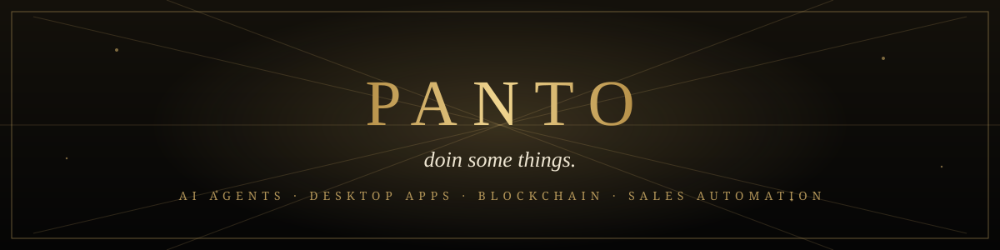

---

### What I'm building

<table>
  <tr>
    <td width="50%" valign="top">
      <a href="https://opencognit.com"><b>🧠 OpenCognit</b></a> 
      Every coding agent in one window — Claude Code, Codex, Gemini CLI, Kimi and Hermes side by side, orchestrated and checked. Local, no telemetry.  
      
      
    </td>
    <td width="50%" valign="top">
      <a href="https://saleshookai.com"><b>🧾 SalesHookAI</b></a> 
      Quotes, invoices, time tracking and scheduling for small businesses and trades — with Zera, an AI that does the office. GoBD, XRechnung, servers in Germany.
    </td>
  </tr>
  <tr>
    <td valign="top">
      <a href="https://mytherrablockchain.org"><b>⛓️ Mytherra</b></a> 
      A SHA-256 proof-of-work network with MYT — open mining, wallets, explorer and the end-to-end encrypted MYT Messenger.
    </td>
    <td valign="top">
      <a href="https://github.com/Panto92/Pillbox"><b>💊 Pillbox</b></a> 
      A calm, modern desktop for KDE Plasma 6 — floating pill panels, muted palette, no compiled code.  
      
    </td>
  </tr>
</table>

### Tools I work with

